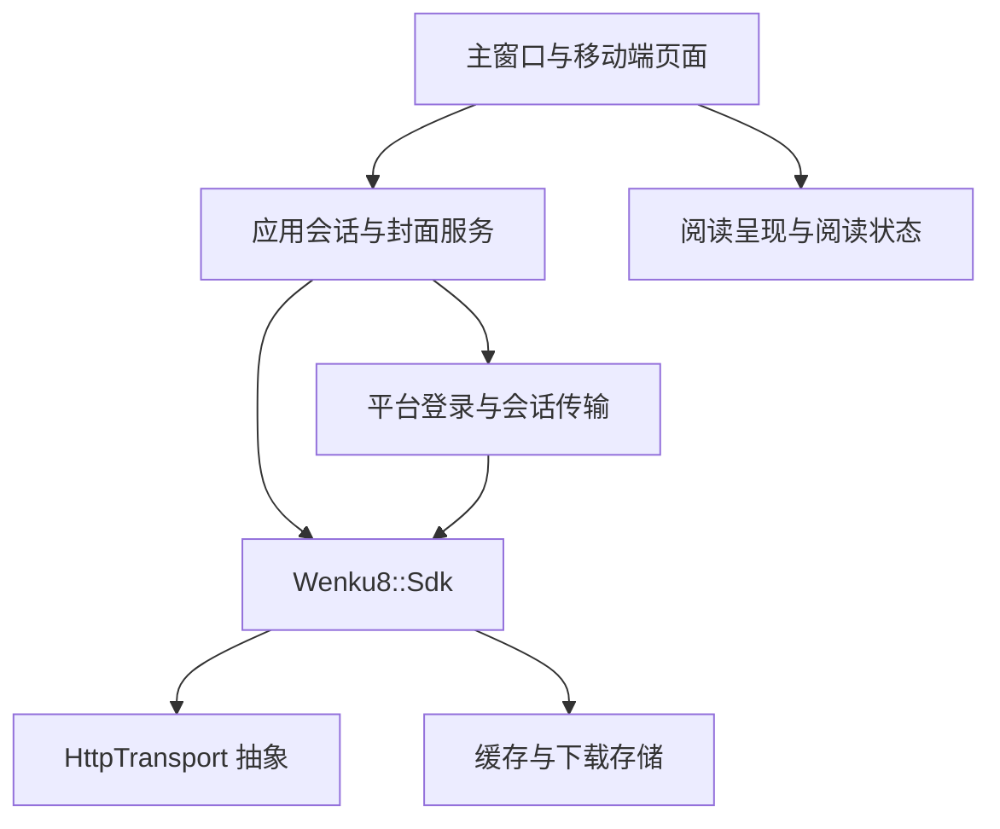

# 架构与 SDK 接入

## 边界

`sdk/` 是独立 C++17 库。公开头文件位于 `sdk/include/`，内部解析器与存储实现位于 `sdk/src/`。它负责请求与协议模型、HTML/XML 解析、错误与取消、有限重试、文件缓存、下载和离线读取，不依赖 Qt 或任何界面。

`platform/` 负责浏览器生命周期与平台事件。Windows 等桌面平台使用 Qt 5 WebEngine；Android 使用系统 WebView。`LoginHost` 是 Qt 应用内部的边界，不属于 SDK 公共接口。浏览器会话请求实现 `HttpTransport`，传给 SDK 处理业务数据；SDK 不读取窗口或 Java 对象。

`app/` 负责展示、阅读排版和应用状态。阅读历史与书签是客户端功能，不反向耦合到协议库。`OnlineSession` 协调后台请求和界面信号，不取代 SDK 的解析与下载实现。



构建目标从公共控件到服务、界面依次连接。平台库只依赖 SDK 与公共控件，避免平台登录引用主窗口而形成静态库循环。

## SDK 公共接口

| 头文件 | 用途 |
| --- | --- |
| `Wenku8Sdk.h` | 数据模型、Client、传输抽象、错误、缓存与重试 |
| `Wenku8Api.h` | 历史协议请求和解析 |
| `Wenku8Catalog.h` | OPDS 目录与文本包入口 |
| `Wenku8Download.h` | 可取消、可续传下载及离线读取 |

其他 CMake 工程可以直接链接库：

```cmake
add_subdirectory(path/to/wenku8_reader/sdk sdk-build)
target_link_libraries(your_application PRIVATE Wenku8::Sdk)
```

也可以在本仓库中只配置 SDK：

```sh
cmake -S . -B build/sdk -DWENKU8_BUILD_CLIENT=OFF
cmake --build build/sdk --config Release
cmake --install build/sdk --config Release --prefix out/sdk
```

`WENKU8_BUILD_SHARED=ON` 生成动态库，`OFF` 生成静态库。CMake 自动传播公开头目录和静态库所需的 `WENKU8_STATIC` 定义。Windows 动态库保留 `WENKU8_API` 导出约定，调用方需使用兼容的编译器、C++ 运行库与构建配置。当前未提供独立 `find_package(Wenku8Sdk)` 配置，建议使用 `add_subdirectory`。

SDK 接口为同步接口，GUI 应放入工作线程。调用方可注入自己的 `HttpTransport`；普通 cURL 请求无法自动完成源站浏览器验证。客户端使用平台会话适配，不关闭 TLS 校验。历史 Android 接口保留兼容实现，其端点和认证依赖服务端现状，不应将它们视为已经确认可用的主站替代服务。

## 本地数据

密码由登录网页处理，不写入项目源码或 SDK 缓存。登录状态由本机浏览器资料目录管理；阅读位置、历史、书签与下载保存在应用数据目录。升级 Windows 版本时继续使用既有应用数据标识，避免重复登录或丢失阅读记录。用户数据不进入 Git 或对应源码归档。
